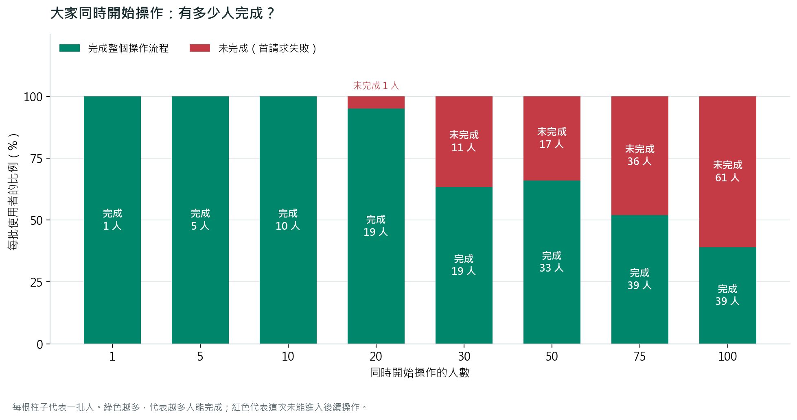
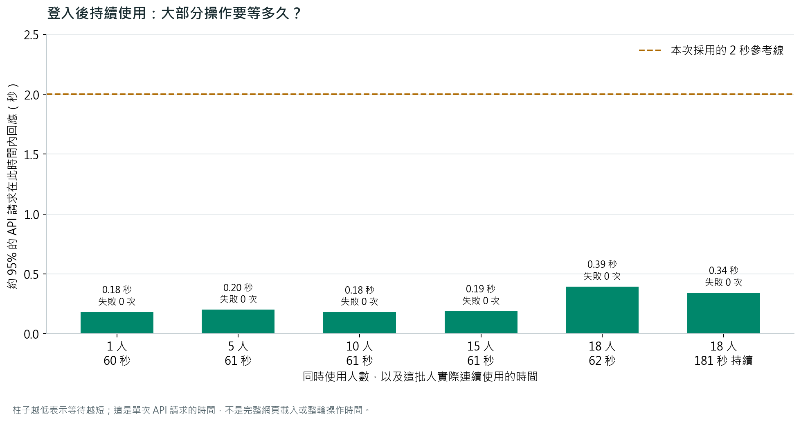

# 新增 100 帳號壓測結果

新增 100 組帳號、300 筆飲食紀錄。持續操作參考門檻通過至 18 人（每級 60 秒），最高通過級別的 180 秒補測通過。此為本次操作頻率與路徑的結果，系統最大可用人數仍未確定。

## 實際結果

- 大家一起開始：100 人同時開始時，39 人完成，61 人在一開始連線失敗。這是持有登入憑證後建立新連線，密碼驗證已提前完成。
- 保持連線繼續使用：已登入後，18 人通過每級 60 秒的連續操作；再測 180 秒的結果為通過。
- 下一級：增加到 20 人時，準備連線就有失敗，未開始該級連續操作。更高持續級別未測，不能把 18 人當作絕對上限。

## 我們怎麼測？

先新增 100 個獨立測試帳號，每人用腳本放入並驗證 3 筆隨機飲食紀錄，共 300 筆。程式實際向網站發送請求，同時操作不同帳號。

1. 測大家一起開始：分批模擬 1、5、10、20、30、50、75、100 人同時建立新連線，各跑一輪操作。查食物、查飲食與歷史紀錄、新增、修改、確認內容及刪除，都成功才算整輪完成。
2. 測已連上後一直用：每種人數先測 60 秒，重複上述讀寫操作，每輪後休息 4–6 秒，模擬閱讀或思考。通過的最高人數再測 180 秒。
3. 看斷線和資料正確性：每 5 秒檢查網站是否回應，同時驗證讀寫內容；測後逐帳號確認保留紀錄正確、臨時紀錄已清掉。

品質參考為完整測完、請求失敗率低於 1%、約 95% 的請求在 2 秒內回應，且每人至少成功一輪、有失敗流程的人數比例低於 1%。回應時間是單次 API 請求耗時，不是整張網頁或整輪操作時間。

## 簡單圖表

每根柱子代表一批同時開始的人。綠色是完成整輪，紅色是未完成。

下面的柱子越低，表示大部分操作等得越短。數字是約 95% 的 API 請求在幾秒內回應。

| 同時使用人數 | 實測時間 | 請求數 | 失敗次數 | 約 95% 請求的回應時間 |
| --- | --- | --- | --- | --- |
| 1 人 | 60 秒 | 70 | 0 | 0.18 秒 |
| 5 人 | 61 秒 | 364 | 0 | 0.20 秒 |
| 10 人 | 61 秒 | 721 | 0 | 0.18 秒 |
| 15 人 | 61 秒 | 1,085 | 0 | 0.19 秒 |
| 18 人 | 62 秒 | 1,274 | 0 | 0.39 秒 |
| 18 人 | 181 秒 | 3,619 | 0 | 0.34 秒 |

## 測後資料與限制

測後驗證 100/100 帳號通過，各保留原 3 筆紀錄；待刪臨時紀錄 0，本輪待登出 token 0。保留紀錄在 11 月 8–10 日，可從歷史紀錄查看；帳密另存，不在本報告內。

這是單一電腦經公開 Funnel 路徑的 API 測試，沒有遠端主機資源監控，本機產生負載也可能影響延遲。未測完整瀏覽器載入、照片辨識、外部 AI／Places 或數小時運行，不能把結果直接套用到所有功能。Tailscale 官方文件未列出 18／19 條並行連線上限，本次結果不能證明有此官方限制。

第一回持續測試因監測視窗誤含突發錯誤而提前停止，該段 1.832 秒／7 次成功請求保留但不列入容量結果。修正並通過離線回歸檢查後，只重測持續部分。

[可單獨分享、圖表已內嵌的 HTML 報告](index.html) · [完整分析與來源雜湊](analysis.json) · [各級數據](stages.csv) · [逐筆請求](requests_combined.csv) · [300 筆保留紀錄](retained_records.csv)
